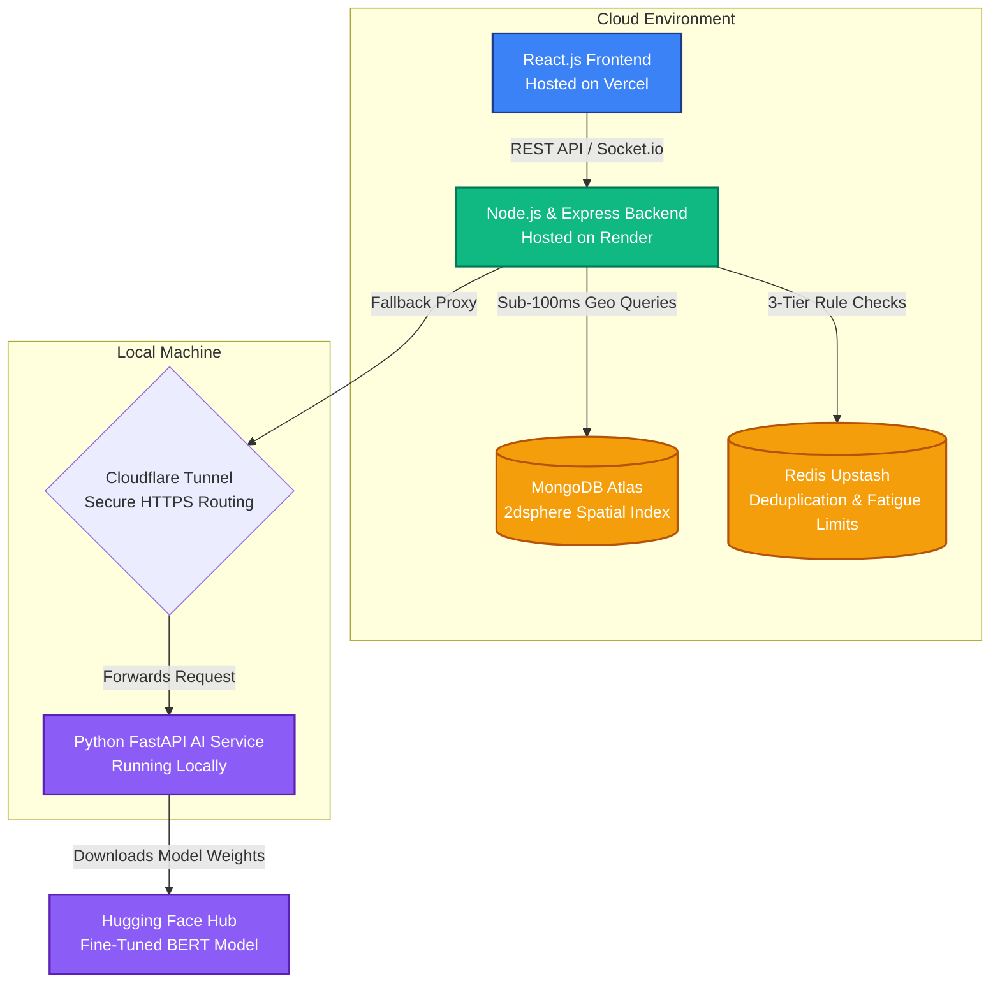

# 🌐 GeoSanket: An AI-Driven Hyper-Local Geo-Fencing Engine

🔗 Live Demo: https://geosanket.vercel.app


GeoSanket is a full-stack, microservices-based civic technology platform designed to bridge the gap between physical public infrastructure and digital information. By combining Deep Learning (NLP), Spatial Databases, and Stateful Behavioral Filtering, GeoSanket automatically pushes verified government project data (budget, completion status, leader) to citizens the moment they physically enter a geofenced zone.

---

## 🏗️ System Architecture

GeoSanket is built on a decoupled microservices architecture to ensure high performance, fault tolerance, and zero-cost deployment for academic research.



---

## ✨ Key Features

### 1. Hybrid NLP Extraction Pipeline
The system extracts structured data (Name, Budget, Leader, Scheme, etc.) from unstructured government press releases.
* **Fine-Tuned BERT:** Fine-tuned `bert-base-multilingual-cased` for Named Entity Recognition (NER) to extract complex entities (Leaders, Departments) in English and Hindi.
* **Rule-Based Fallback:** A context-scoring Regex engine handles numerical extraction (Sanctioned vs. Spent budgets).
* **Dataset Auditing:** Built an `audit_dataset.py` script to eliminate "Shortcut Learning" (positional bias) from the synthetic training data, resulting in a **0.975 Lenient Micro-F1 Score**.

### 2. Behavioral Notification Filtering
To prevent notification fatigue, the backend uses a 3-Tier Stateful Expert System via Redis:
* **Tier 1 (24-Hour Deduplication):** Prevents redundant alerts within a 24-hour window.
* **Tier 2 (Dwell-Time Threshold):** Requires the user to stay inside the zone for 300 seconds, filtering out drive-by transit.
* **Tier 3 (Daily Frequency Cap):** Limits users to 5 notifications per day, returning a `suppressed_fatigue` state if exceeded.

### 3. Spatial Intelligence
Utilizes MongoDB `2dsphere` indexing to execute `$near` geospatial queries. The backend resolves a user's GPS coordinate against thousands of active zones in **under 50 milliseconds**.

---

## 📁 Repository Structure

```text
GeoSanket/
├── backend/                  # Node.js + Express API
│   ├── src/
│   │   ├── models/           # Mongoose schemas (Zones, Projects, Users)
│   │   ├── routes/           # REST endpoints (auth, location, ai, etc.)
│   │   ├── services/         # Redis and Notification services
│   │   └── socket/           # Socket.io WebSocket logic
│   └── package.json
├── frontend/                 # React.js + Vite (Citizen & Admin Panels)
│   ├── src/
│   │   ├── components/       # Reusable UI (AIExtractBox, Maps)
│   │   └── pages/            # Admin Dashboard, Login, Live Map
│   └── package.json
├── ai-service/               # Python FastAPI NLP Microservice
│   ├── main.py               # FastAPI entry point
│   ├── extractor.py          # Rule-based NLP logic
│   ├── ner_model.py          # BERT model inference logic
│   └── requirements.txt
└── ml/                       # Machine Learning Pipeline
    ├── make_dataset.py       # Synthetic data generation
    ├── audit_dataset.py      # Dataset bias auditor
    ├── train_ner.py          # BERT fine-tuning script (Colab T4)
    ├── compare.py            # Strict/Lenient F1 evaluation
    └── push_to_hub.py        # Uploads model to Hugging Face
```

---

## 🚀 Local Setup & Installation

### Prerequisites
* Node.js (v18+)
* Python (v3.10+)
* MongoDB Atlas Account
* Upstash Redis Account
* Cloudflare (`cloudflared` installed locally)

### 1. Backend Setup
```bash
cd backend
npm install
```

Create a `.env` file in the `backend/` directory:
```env
PORT=5000
MONGO_URI=your_mongodb_connection_string
JWT_SECRET=your_jwt_secret
REDIS_URL=your_upstash_redis_url
AI_SERVICE_URL=http://localhost:8000
AI_BERT_URL=your_cloudflare_tunnel_url
FIREBASE_PROJECT_ID=...
FIREBASE_CLIENT_EMAIL=...
FIREBASE_PRIVATE_KEY=...
```

Start the backend:
```bash
npm run dev
```

### 2. Frontend Setup
```bash
cd frontend
npm install
```

Create a `.env` file in the `frontend/` directory:
```env
VITE_API_URL=http://localhost:5000
VITE_SOCKET_URL=http://localhost:5000
```

Start the frontend:
```bash
npm run dev
```

### 3. AI Microservice Setup
```bash
cd ai-service
python -m venv venv

# Activate virtual environment:
# Windows:
venv\Scripts\activate
# Mac/Linux:
source venv/bin/activate

pip install -r requirements.txt
pip install -r requirements-ml.txt
```

Set your Hugging Face Model ID (so it loads directly from the Hub without needing local training):
```bash
# Windows CMD:
set NER_MODEL_ID=whitedevilcoder/geosanket-ner

# Windows PowerShell:
$env:NER_MODEL_ID="whitedevilcoder/geosanket-ner"

# Mac/Linux:
export NER_MODEL_ID=whitedevilcoder/geosanket-ner
```

Start the FastAPI server:
```bash
uvicorn main:app --port 8000
```

### 4. Expose AI Service (Cloudflare Tunnel)
To allow your Render backend to communicate with your local BERT model, run:
```bash
cloudflared tunnel --url http://localhost:8000
```
Copy the generated `https://...trycloudflare.com` URL and set it as `AI_BERT_URL` in your Render Environment Variables.

---

## 📊 Evaluation & Results

### NLP Extraction (Held-Out Test Set)

| System | Strict F1 | Lenient F1 | Key Strength |
| :--- | :---: | :---: | :--- |
| **Rule-Based Baseline** | 0.909 | 0.912 | High accuracy on numerical context |
| **Fine-Tuned BERT** | 0.916 | 0.963 | High accuracy on entity names (Leader/Scheme) |
| **Hybrid (BERT + Rules)** | **0.929** | **0.975** | Combines contextual NER with exact numeric extraction |

### Behavioral Filtering (Redis)
* Successfully validated the `suppressed_fatigue` state when the daily notification count reaches 5 per user.

### Spatial Latency (MongoDB)
* `$near` query using `2dsphere` index resolves intersecting zones in **~45 milliseconds**.

---

## 🤗 Model Hub
The fine-tuned multilingual BERT model is hosted on Hugging Face:  
**[whitedevilcoder/geosanket-ner](https://huggingface.co/whitedevilcoder/geosanket-ner)**

---

## 📜 License

```text
MIT License

Copyright (c) 2026 GeoSanket Team

Permission is hereby granted, free of charge, to any person obtaining a copy
of this software and associated documentation files (the "Software"), to deal
in the Software without restriction, including without limitation the rights
to use, copy, modify, merge, publish, distribute, sublicense, and/or sell
copies of the Software, and to permit persons to whom the Software is
furnished to do so, subject to the following conditions:

The above copyright notice and this permission notice shall be included in all
copies or substantial portions of the Software.

THE SOFTWARE IS PROVIDED "AS IS", WITHOUT WARRANTY OF ANY KIND, EXPRESS OR
IMPLIED, INCLUDING BUT NOT LIMITED TO THE WARRANTIES OF MERCHANTABILITY,
FITNESS FOR A PARTICULAR PURPOSE AND NONINFRINGEMENT. IN NO EVENT SHALL THE
AUTHORS OR COPYRIGHT HOLDERS BE LIABLE FOR ANY CLAIM, DAMAGES OR OTHER
LIABILITY, WHETHER IN AN ACTION OF CONTRACT, TORT OR OTHERWISE, ARISING FROM,
OUT OF OR IN CONNECTION WITH THE SOFTWARE OR THE USE OR OTHER DEALINGS IN THE
SOFTWARE.
```
## Team 
GeoSanket

## Live Link 
🔗 Live Demo: https://geosanket.vercel.app

## Github Link
🔗 GitHub Link: https://github.com/shubhu2131/GeoSanket